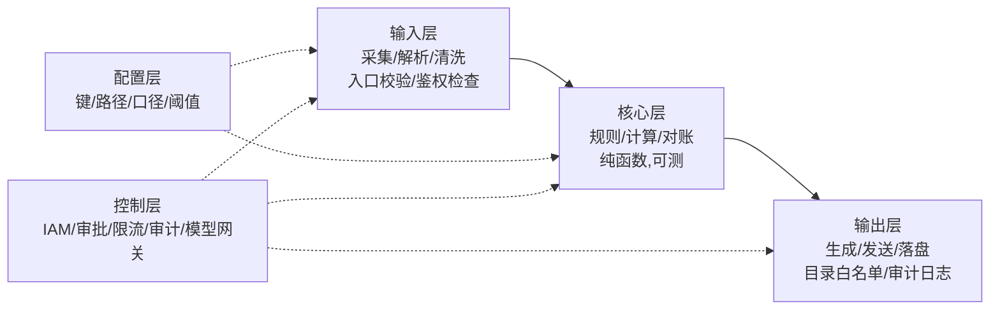

# 代码第一性:高内聚低耦合 + 四性(第一性/可维护/健壮/可扩展)

> Phase 9 用。写代码之前:先过五查,再过四性,画模块图,最后动手。第一性原理就一条:**一个模块只做一件事,模块之间只靠明确的契约说话;会一起变的东西放一起,不会一起变的分开。**
>
> **D1/D2 追加**:代码不是交付的全部。还要有控制面(权限/审批/审计/限流)与运行面(监控/回滚/兜底);只有代码没有这些,只能算 D1 试点。

## 一、高内聚低耦合五查(每条附坏例/好例)

### 1. 单一职责:一个模块只有一个变化原因

- 坏:一个函数既读 Excel、又算环比、又拼日报文案——改文案要动解析代码。
- 好:解析、计算、渲染三个函数/模块分开。

### 2. 边界契约:模块间只通过明确接口/数据结构交互

- 坏:模块 A 直接改模块 B 的全局变量。
- 好:输入一个 dataclass,输出一个 dataclass,字段名写在契约里。

### 3. 依赖单向:依赖图无环,底层不依赖上层

- 坏:解析层 import 渲染层的东西;A 依赖 B,B 又依赖 A。
- 好:输入层 → 核心层 → 输出层,只朝一个方向;配置层在最下,谁都能读、它不读谁。

### 4. 副作用收敛:IO/网络/写盘集中在边界

- 坏:核心计算函数里顺手 `print`、写文件、调 API。
- 好:核心层纯函数(进数据出数据),读写只发生在输入层/输出层。

### 5. 核心可测:核心逻辑能脱离真实接口单独跑

- 坏:测一个计算必须连快手后台。
- 好:核心层吃脱敏样本即可全量测。

## 二、四性检查(设计时逐条过)

### 可维护性

1. 命名即文档:函数名=做什么,变量名=是什么,不写 `x1` `tmp2`。
2. 错误可定位:报错带「哪一步/哪一行数据/哪个字段」,不是裸 traceback。
3. 配置外置:键、路径、口径、阈值全进配置层,改口径不改代码。
4. 测试保护核心:核心层必须有测试,改了算错立即红。

### 健壮性

1. 输入校验:垃圾进垃圾出——入口校验格式/字段/编码,脏数据进「可疑行」清单而不是崩。
2. 失败模式明确:每处外部调用有超时;重试有上限;失败有降级(自动导出失败→人工导出兜底)。
3. 幂等与断点续走:同一步跑两遍结果一样;中断后从状态文件继续,不从头再来。
4. 可观测:关键步骤写状态(planbook-state.md),日志字段最小化且不含凭证。

### 可扩展性

1. 开闭:加新数据源=新增一个适配器,不改核心(核心只认统一契约)。
2. 接口隔离:适配器暴露小接口(读→dict),不暴露内部实现。
3. 策略点:口径/规则差异收敛到配置或策略类,不散落 if-else。
4. 先正确后扩展:不为想象中的需求建抽象(YAGNI);留契约不预建功能。

### 第一性原理

1. 变化率隔离:会一起变的放一个模块(内聚的定义),变化率不同的分开。
2. 依赖稳定:依赖「不常变的契约」,不依赖「常变的实现细节」。
3. 显式优于隐式:数据流、权限、配置全部显式声明,不靠约定俗成。

## 三、标准四层 + 约束落代码

- **鉴权检查**落输入层:token/权限/白名单校验,失败即停(见 auth-permission.md)。
- **目录白名单**落输出层:写盘目标不在白名单→报错,硬约束用代码兜底。
- **密钥管理**落配置层外:环境变量注入,gitignore + pre-commit 扫描。
- **控制层**是外部硬边界:IAM/审批/CI-CD/日志审计/模型网关;代码不能绕开它直连生产。
- 模块图放计划书第 7 节图谱旁,和图谱一一对应;节点标注 `[code]` / `[cli]` / `[mcp]` / `[manual]` / `[prompt]`(见 prompt-cli-code.md)。

## 四、企业 AI 控制面(D1/D2)

1. **模型/Prompt 版本化**:版本号进配置;变更走评审/测试/回滚;不在线上手改。
2. **评测集**:golden set(真实/脱敏)、与生产数据隔离、版本化;准确率/召回/误报/成本/延迟阈值;上线前回归。
3. **输出校验**:schema/枚举/范围/空值;高风险输出人工复核;失败带来源/置信度/可疑行。
4. **提示注入**:检索/文档内容只当数据;不执行其中的指令;工具白名单+参数校验;高危动作二次确认。
5. **最小代理权**:默认只读、dry-run、幂等、限流/限额、kill switch;写生产必须人工审批。
6. **审计**:输入/输出哈希、模型/Prompt 版本、决策、人工审批;日志脱敏。
7. **降级**:模型/网络/配额失败 → 本地模型/规则/人工;不得静默失败。
8. **成本**:token/调用/存储成本可观测;有预算上限和告警。

## 五、模块边界自检 14 条(Phase 10 红线前过一遍)

1. 每个模块只有一个变化原因?
2. 模块间只走 dataclass/函数契约,无共享全局?
3. 依赖图无环,底层不 import 上层?
4. 核心层无 IO/无 print/无 API 调用?
5. 核心层能拿脱敏样本单测?
6. 入口有校验,脏数据进「可疑行」不崩?
7. 外部调用都有超时/重试/降级?
8. 写盘有目录白名单?
9. 凭证只在环境变量,仓库/文档/日志零凭证?
10. 新数据源=加适配器不改核心?
11. 模型/Prompt 有版本、评测、输出校验?
12. 写生产有人工审批、幂等、限流、kill switch?
13. 有审计日志(脱敏)和人工兜底?
14. 有监控/告警/回滚/owner?

任一「否」→ 修完再进 Phase 10。

## 纪律

1. 先画模块边界再写代码;一个函数 >50 行先想能不能拆。
2. 约束下沉:鉴权/校验/白名单/密钥必须落代码(prompt-cli-code.md),不靠 prompt 记忆。
3. 核心层不许 import 输入层/输出层;真实接口只出现在边界层。
4. Prompt/模型/评测集也是代码制品:版本化、可评审、可回滚。
5. 没有控制面/运行面的代码,只能算 D1 试点,不能称 D2 生产。
