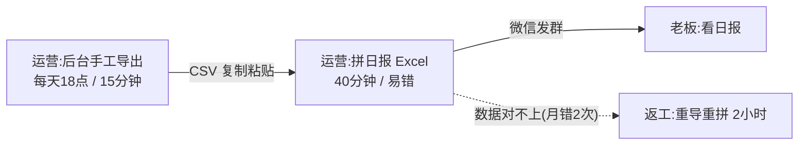

# 现状流程复刻 + 隐患扫描

> Phase 5 用。目标:把「现在这件事怎么做」画出来,找出哪里不正确、哪里隐患大。画的是**实际发生**的流程,不是理想流程。
>
> **D1/D2 追加**:除了业务隐患,还要扫控制隐患。控制隐患常常不是「出错」,而是「无法证明没出错」。

## 复刻法

1. 找最清楚完整流程的人(通常是一线,不是拍板主管),问:「从第一步到最后一步,你实际怎么做?」
2. 有交接文档/旧流程图/微信群置顶 SOP?先读,再对人核。
3. 逐节点收集六要素:**谁 / 动作 / 数据 / 频率 / 耗时 / 错点**(哪里容易错、错过什么、谁擦屁股)。

## mermaid 模板



红标规则:**节点标红的条件**——出现过事故证据(投诉/返工/被骂/加班),或六要素里「错点」不为空。红标节点是 Phase 6 重规划提案的原料。

## 隐患扫描清单(逐节点对照)

| 隐患 | 线索 | 后果 |
|---|---|---|
| 返工点 | 同一动作重复做/重导重拼 | 时间翻倍,一线怨气 |
| 人肉桥 | 复制粘贴/截图/手工核对 | 错误率随行数上升 |
| 对不上 | 两份数据口径不一致 | 纠纷/背锅 |
| 无校验 | 发出去前没人检查 | 错漏直接到老板/客户 |
| 单点权限 | 只有一个人能导出 | 请假即断流 |
| 责任盲区 | 谁负责哪段没人说清 | 出事了互相推 |
| 加班补偿 | 靠加班兜底的事故 | 隐患被掩盖,迟早爆 |
| 临时 Excel 王 | 全靠某个人的私藏表 | 人走流程亡 |

## 企业控制隐患(D1/D2 追加)

| 隐患 | 线索 | 后果 |
|---|---|---|
| 审批等待 | 权限/模型/数据申请卡在一个人/一个会 | 项目停摆,48h 被拖成数周 |
| 人工复核瓶颈 | 所有输出都要同一个人看 | 规模上不去,复核人成单点 |
| 职责冲突 | 同一人开发+审批/发布/审计 | 无法追责,审计不过 |
| 审计缺口 | 没有操作日志/审批记录/版本记录 | 出事后无法证明,无法复盘 |
| 回滚缺口 | 没有回滚方案/没演练 | 上线失败只能手工救火 |
| 模型/供应商单点 | 只有一个未批准端点/一个供应商 | 断供即停,或被迫违规切换 |
| 变更冻结 | 月末/季末/审计期不能发布 | 交付窗口被压缩,需提前排期 |
| 数据边界漂移 | 测试数据混生产/日志带敏感字段 | 泄露/合规事件 |
| 影子 IT | 个人网盘/脚本/账号绕过 IT | 无法审计,随时被叫停 |

## 产出模板

```
## 现状流程与隐患
<mermaid 流程图>
| 节点 | 隐患 | 证据(事故/返工/加班) | 严重度(红/黄) | 建议 |
```

## 纪律

1. 只画**实际**流程;理想流程画进 Phase 7 的新图。
2. 红标必须有证据;没证据的隐患标「疑点,待确认」。
3. 每个红标节点在 Phase 6 必须对应一个选项(A 保留 / B 绕过 / C 砍掉);**控制类红标没有 C(砍掉控制)**,只能优化实现。
4. D1/D2 的红标证据可以是:审计发现、权限拒绝、审批超时、回滚失败、日志缺失、安全事件。
